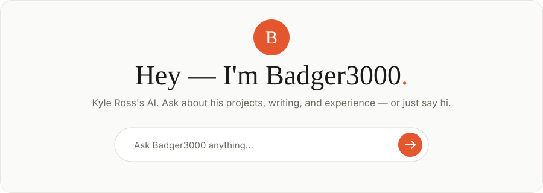

<a href="https://www.badger3000.com">
  <picture>
    <source media="(prefers-color-scheme: dark)" srcset="assets/readme/hero-dark.svg">
    
  </picture>
</a>

**Kyle Ross** · Frontend developer · 17+ years

[Recent experiments](https://www.badger3000.com/codepen) · [Latest articles](https://www.badger3000.com/articles) · [Experience](https://www.badger3000.com/experience)

---

## About

I build scalable web applications for companies like **Sony**, **Samsung**, and **Headspace**. These days that means modern JavaScript frameworks, AI integration, and being a founding member of a couple of things.

My site is an AI you can talk to: ask it about my projects, writing, and experience at [badger3000.com](https://www.badger3000.com).

---

## Built with

**Frontend & frameworks** 

**Styling & animation** 

**Content, tools & platforms** 

---

## Latest posts

<!-- BLOG-POST-LIST:START -->
- [I Built a 5 Tool AI Stack Where Each Tool Does Something the Others Cannot. Here Is the Full Build.](https://www.badger3000.com/articles/i-built-a-5-tool-ai-stack-where-each-tool-does-something-the-others-cannot-here-is-the-full-build)
- [Your LLM Is Burning Through Tokens - Karpathy Found a Way to Save 90%](https://www.badger3000.com/articles/your-llm-is-burning-through-tokens-karpathy-found-a-way-to-save-90)
- [GSAP + Locomotive Scrolling Landing Page](https://www.badger3000.com/codepen/gsap-locomotive-scrolling-landing-page)
- [Spotlight Navigation POC - GSAP Enhanced](https://www.badger3000.com/codepen/spotlight-navigation-poc-gsap-enhanced)
- [CSS Grid Tabs - Responsive Desktop/Mobile (2025)](https://www.badger3000.com/codepen/css-grid-tabs-responsive-desktop-mobile-2025)
<!-- BLOG-POST-LIST:END -->
